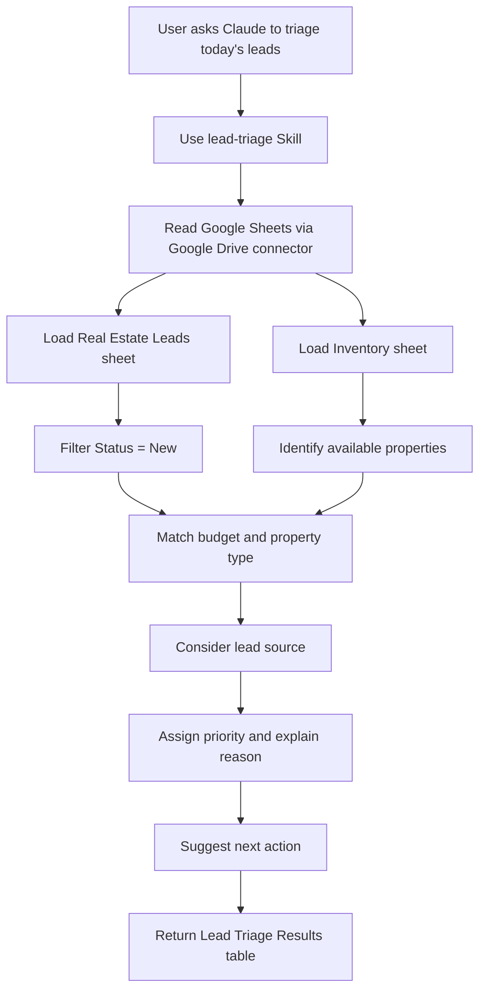

# Real Estate Lead Triage Assistant

A Claude Skill that helps a real-estate team prioritize new leads by checking a Google Sheets lead list against available property inventory. It considers budget fit, property type, lead source, and lead status, then returns a structured triage table with a priority, reasoning, and suggested next action.

> **Project type:** Claude Skill + Google Drive/Google Sheets connector. This is not an n8n workflow export. No JSON workflow file was supplied in the project materials.

## The business problem

Real-estate teams can lose time reviewing new inquiries one by one and manually comparing each prospect's budget and property needs against current inventory. This Skill supports a repeatable first-pass review so staff can focus on the most relevant new leads.

## What the Skill does

Based on the supplied Skill screenshot, spreadsheet, and reflection document, the intended workflow is to:

1. Read the real-estate lead data from the connected Google Drive/Sheets source.
2. Read the property inventory data.
3. Filter to leads whose status is `New`.
4. Compare lead budget and requested property type with available inventory.
5. Consider lead source when assigning priority.
6. Return a triage table containing the lead name, budget, source, property type, priority, reason, and suggested action.

The supplied reflection says the final scoring logic prioritized leads based on budget matching and lead source, and excluded leads whose status was not `New`. It also notes that clearer instructions about the spreadsheet, lead sheet, inventory sheet, and filtering rules resolved an initial source-selection issue.

## Workflow diagram



## Data sources

The supplied workbook contains two tabs:

- **Real Estate Leads:** Name, Email, Phone, Budget, Source, Property Type, Status, Lead Date.
- **Inventory:** Property, Property Type, Price, Availability.

The sample inventory includes three available properties: a 3-bedroom Green Valley Residence at $450,000, a 2-bedroom Lakeview Apartment at $300,000, and a 4-bedroom Downtown Villa at $600,000.

## Example result format

The screenshot shows a table with these columns:

| Name | Budget | Source | Property Type | Priority | Reason | Suggested Action |
|---|---:|---|---|---|---|---|
| John Smith | $450,000 | Referral | 3 Bedroom | High | Budget and property type match available inventory | Call today with Green Valley Residence details |
| Sophia Anderson | $600,000 | Hot Listing Inquiry | 4 Bedroom | High | Budget and property type match available inventory; high-intent source | Call today, send property details, and arrange a viewing |

These rows reflect the supplied screenshot. Treat them as example evidence from the provided materials, not as a guarantee that every run will return the same priorities.

## Setup guide

### Requirements

- Claude account with Skills available.
- A Google Drive/Google Sheets connector connected and authorized.
- Access to a spreadsheet containing a lead sheet and an inventory sheet.
- A Skill configured with the name `lead-triage` and instructions that identify the correct spreadsheet, sheet names, status filter, matching rules, output columns, and suggested-action format.

### Setup steps

1. Upload or place your lead and inventory workbook in Google Drive.
2. Confirm the workbook has separate lead and inventory tabs with clear column headers.
3. Connect Google Drive in Claude and authorize access to the intended file.
4. Create or open the `lead-triage` Skill.
5. In the Skill instructions, name the spreadsheet and both tabs explicitly. Do not rely on vague instructions such as “find the leads sheet.”
6. Define the filter rule: only include records with status `New`.
7. Define how budget, property type, and lead source affect priority. Keep these rules explicit and auditable.
8. Require the output columns: Name, Budget, Source, Property Type, Priority, Reason, Suggested Action.
9. Ask Claude to triage today's leads and verify that it used the correct tabs and only included eligible records.
10. Compare the results against the workbook manually before using the recommendations with clients.

### Example prompt

```text
Use the lead-triage Skill to review today's new real-estate leads.

Read the Real Estate Leads and Inventory tabs from the connected workbook.
Only include leads with Status = New.
Match each lead's budget and property type against currently available inventory.
Consider the lead source when assigning priority.
Return a table with Name, Budget, Source, Property Type, Priority, Reason, and Suggested Action.
If budget, property type, source, or inventory availability is missing or inconsistent, flag it for review instead of guessing.
```

## Validation and testing

See [`docs/test-plan.md`](docs/test-plan.md). Test at least:

- A new lead whose budget and property type match an available property.
- A new lead whose budget does not match current inventory.
- A lead with status `Contacted` (should be excluded).
- Missing or inconsistent budget.
- Missing property type or lead source.
- No available property matching the lead.
- An ambiguous or duplicate lead record.
- A connector/file access failure.

## Business impact

The intended benefit is less manual spreadsheet scanning and a more consistent first-pass prioritization process. Actual time saved, conversion improvement, and prioritization accuracy have not been measured in the supplied materials, so this repository does not claim numerical results.

To measure impact, compare a sample of leads triaged manually versus with the Skill. Track:
- Time to produce a triage list.
- Percentage of recommendations accepted by the agent.
- Correct exclusion rate for non-`New` leads.
- Match accuracy against current inventory.
- Number of cases flagged because required data was missing.
- Time from lead arrival to first human follow-up.

## Screenshots and demo

Place sanitized screenshots in [`screenshots/`](screenshots/). The supplied screenshots can be used as visual evidence after cropping any account names or unrelated interface details. Recommended captures:
1. The Skill overview and instructions.
2. A full-width triage result table.
3. The connected Google Drive connector.
4. A test where a `Contacted` lead is excluded.
5. A test where missing budget/property data is flagged.

A 45–60 second recording plan is available in [`docs/demo-script.md`](docs/demo-script.md).

## Known limitations and next improvements

The reflection document identifies these next steps:
- Add stricter validation for missing or inconsistent budget.
- Add stricter validation for property type.
- Add stricter validation for lead source.
- Continue testing with more real-world lead data and edge cases.

Additional recommended safeguards:
- Make the priority rules explicit and explainable.
- Verify inventory availability immediately before a suggested viewing.
- Avoid exposing personal contact information in public screenshots.
- Require a human to approve outreach actions.
- Keep the spreadsheet as the source of truth; do not let the Skill invent unavailable property details.

## Repository structure

```text
.
├── README.md
├── docs/
│   ├── workflow-diagram.mmd
│   ├── test-plan.md
│   └── demo-script.md
├── examples/
│   └── sample-triage-prompt.md
├── data/
│   └── README.md
└── screenshots/
    └── README.md
```

## License

Choose a license only after confirming you have permission to share the Skill instructions and sample data. The workbook contains contact fields; do not publish it as-is unless it is sanitized or you have permission.
